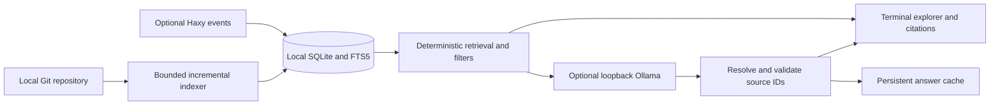

# Haxy Time Machine AI

**An offline-first Git repository historian with local AI and verifiable historical code citations.**

Explore how an ordinary Git project evolved: search commit messages and diffs, inspect changes at the correct historical lines, and optionally ask a small local Ollama model to explain the evidence. Deterministic retrieval and CPU inference are the defaults. No paid API, cloud inference, embeddings service or vector database is required.

Haxy event reconstruction is an additional capability, not a requirement. This is an independent project inspired by [Haxy](https://github.com/xit-vcs/haxy), not an official Haxy application.

[View a genuine captured dashboard transcript](docs/dashboard.txt). This is text from the running application, not a fabricated screenshot.

## Why use it?

Commit messages explain part of a project's history. Diffs show another part. This tool keeps them together, stores bounded evidence locally, and lets you inspect the exact source behind an explanation—including deleted code at its old parent snapshot.

It is intended for developers investigating a refactor, reviewing a change, learning an unfamiliar module, or collecting possible explanations for a regression. It does not execute repository code or prove that a suspected regression is causal.

## Features

- **Ordinary Git history:** commit hashes, authors, parents, messages, changed paths, rename information, patches and line-level evidence.
- **Historical citations:** full change SHA, old/new path, line range, evidence kind, parent index and snapshot SHA. Select numbered citations in the terminal to inspect stored diffs.
- **Local AI:** optional Ollama explanations separated into verified facts, interpretations, hypotheses and missing information.
- **Deterministic search:** SQLite FTS5 plus message, path, ancestry, author and date signals before inference.
- **Offline memory:** persistent SQLite storage and content-hash caches; previously indexed evidence works without internet access.
- **CPU first:** small installed models, bounded context/output, optional partial GPU offload, measured resource reporting and busy-GPU fallback.
- **Timeline exploration:** frequently changed files, co-change counts, commit clusters and revision comparisons.
- **Optional Haxy mode:** issue/discussion reconstruction, event time travel and explicit public event synchronization.
- **Windows launcher:** no pip dependencies or heavyweight UI framework.

## Install on Windows

1. Install **Python 3.10 or newer**, including its PATH option. Official Windows builds include SQLite FTS5. Check `python --version`.
2. Install **Git for Windows** and check `git --version`.
3. Optionally install **Ollama** and an appropriately licensed small local completion model. The tested model was `qwen3.5:4b` in Q4_K_M quantization. This application never downloads models automatically.
4. Clone this repository:

```powershell
git clone https://github.com/TRYINGTHINGSYO/haxy-time-machine-ai.git
cd haxy-time-machine-ai
.\launch.ps1
```

Alternatively, extract the versioned ZIP from [Releases](https://github.com/TRYINGTHINGSYO/haxy-time-machine-ai/releases) and open PowerShell in the extracted folder.

If script execution is blocked, run `python -m htmai.app` directly. After reviewing the launcher, a process-scoped alternative is `powershell -NoProfile -ExecutionPolicy Bypass -File .\launch.ps1`. The app does not change your execution policy.

The first launch creates its own ignored `data/` directory and imports the **synthetic demonstration fixture**. No developer database or real user history is needed. The demo contains eight fictional issues and one fictional discussion; its IDs and hashes are test identifiers, not real Git objects.

```powershell
.\launch.ps1 -Doctor
.\launch.ps1 -Mode deterministic
.\launch.ps1 -Mode cpu -Model qwen3.5:4b
```

For AI, start the installed Ollama app or `ollama serve`. Use `ollama list` to inspect installed models. Choose a compatible installed model with `-Model NAME`, or use `-Model auto` for the smallest suitable installed standard completion model within the configured size ceiling. Search and history inspection still work with Ollama stopped.

## Index a real project

From the dashboard:

```text
repos
git-add my-project C:\path\to\repository
git-search parser
git-ask How did this function evolve?
git-ai Explain why this code changed
git-timeline
git-performance
```

Use a function name, path or explicit SHA to narrow broad questions. `git-ask` stays deterministic; `git-ai` explicitly adds local interpretation. `cite 1` opens the first source from the last answer. `git-show SHA` opens commit metadata and changes; `git-compare OLD NEW` compares indexed revisions.

The equivalent CLI supports author/date/path filters:

```powershell
python -m htmai.app --repo my-project git-index "C:\path\to\repository" --limit 200
python -m htmai.app --repo my-project git-ask "How did parse evolve?" --path src/parser.py
python -m htmai.app --repo my-project git-ask "Why was parse modified?" --path src/parser.py --ai
python -m htmai.app --repo my-project git-ask "parse" --author "A Developer" --since 2026-01-01
```

Global options precede subcommands. Repeat `git-index` after updating the local repository; unchanged indexed commits are reused. This reads your checkout and updates the app's database without modifying branches or executing project code. The older metadata-only `index-commits` interface remains available.

## Architecture



Git supplies authoritative commits and diffs. SQLite stores evidence, history generations and indexes. Retrieval selects a bounded source set. The model chooses existing evidence IDs; the app derives the original code, commit, path and line range from stored records. Source text is untrusted input, never executable instructions.

The original Haxy viewer remains in `time_machine.py`. Real Haxy data can be fetched explicitly into local-only storage:

```powershell
python -m htmai.app sync haxy-live https://try.haxy.net/haxy:haxy
python -m htmai.app --repo haxy-live overview
```

The preview server's availability and retained data are external to this project. This repository does not redistribute its users' comments or attachments.

## Resource controls and benchmarks

Default inference is CPU (`num_gpu=0`), context 4096, output cap 384 tokens, and a 30-second idle expiry. `config.json` controls model, context budget, output length, GPU layers, timeout and retrieval limits. Loopback HTTP only; remote model aliases, redirects and cloud-tagged models are rejected. No automatic model pulls.

GPU mode uses partial offload and checks observed device utilization/headroom first. It may fall back to CPU; it does not reserve all VRAM. Layer count is not a hard memory cap. Monitor reports actual model allocation separately from device-wide use.

**Previously recorded on October 15, 2026**, against a public twelve-commit xitui window using qwen3.5:4b Q4_K_M, eight CPU threads, context 4096 and 12 GPU layers:

| Case | Requests | Mean latency | Median latency | Peak sampled model VRAM |
|---|---:|---:|---:|---:|
| CPU, warm and uncached | 5 | 7.58 s | 7.14 s | 0 |
| Partial GPU, warm and uncached | 5 | 6.01 s | 5.20 s | 1.26 GiB |
| CPU cold start | 1 | 14.50 s | — | 0 |
| Partial GPU cold start | 1 | 11.05 s | — | 1.26 GiB |

Recorded median search time was 2.46 ms over 30 searches; persistent-cache reads were 7.46 ms over 10 hits. These are historical measurements, **not newly measured release performance** or guarantees. Other applications were active, outputs varied in length, warm requests could reuse Ollama prompt state, and sampled peaks may miss transients. A fallback attempt was excluded rather than counted as GPU inference.

See [GIT_PERFORMANCE.md](GIT_PERFORMANCE.md) and the reviewed aggregate [git-benchmarks.json](git-benchmarks.json). Raw runtime samples and model conversations are intentionally excluded from publication. To measure your own indexed repository:

```powershell
python benchmark_git.py --repo my-project --inference --runs 5
```

Use `--question` to choose a question relevant to your project. New benchmark reports are saved under ignored `data/benchmarks/`; `git-performance` prefers those local measurements when present. Review and sanitize results before sharing. No cached request counts toward an inference group.

## Reliability and limits

The release tests preserve Haxy reconstruction, ordinary Git indexing, diff parsing, renames, deletions, merge-parent handling, shallow boundaries, exact citations, cache invalidation/bypass, missing evidence and CPU fallback. Run:

```powershell
python -m unittest discover -v
```

Windows is the release-tested platform. The workflow tests Python 3.12 and 3.14 on Windows. Other platforms are not claimed as release-tested.

Indexing is bounded: 200 commits by default, 100 files per parent and 256 KiB per file patch. Missing shallow parents, binary changes, submodule pointers and oversized patches carry explicit warnings. Ordinary Git merges use separate comparisons to each parent; Haxy's own merged-event conflict semantics are not emulated. Revision comparison needs the original local Git objects; stored citations and diffs remain inspectable offline.

Correct citations do not prove an AI interpretation true. Regression causality, runtime behavior and unstated intent may require testing and human review. The tool never executes a repository's code. FTS retrieval is lexical rather than general semantic understanding.

## Troubleshooting

- **Ollama unavailable:** use deterministic mode, start the installed Ollama server, and run `launch.ps1 -Doctor`.
- **No suitable model:** choose an installed small completion model. Installation is a separate user action.
- **Another model is resident:** wait for its expiry or unload it yourself. This app does not evict another application's model.
- **No code evidence:** narrow the path/question, index more commits, and inspect shallow/binary/size warnings.
- **No benchmark data for your project:** `git-performance` initially shows the historical release aggregate. Run the benchmark explicitly to replace it with local measurements.
- **FTS5 unavailable:** use an official Python build that includes SQLite FTS5.

More detail: [Git Intelligence guide](GIT_INTELLIGENCE.md), [migration](MIGRATION.md), [historical example](GIT_EXAMPLES.md), [contributing](CONTRIBUTING.md), and [third-party/data notices](THIRD_PARTY_NOTICES.md).

## License

Original project code, documentation and synthetic demo fixture: [MIT](LICENSE). Third-party code and user-supplied repositories retain their own licenses. The xitui notice is preserved in [XITUI_LICENSE.txt](XITUI_LICENSE.txt).
